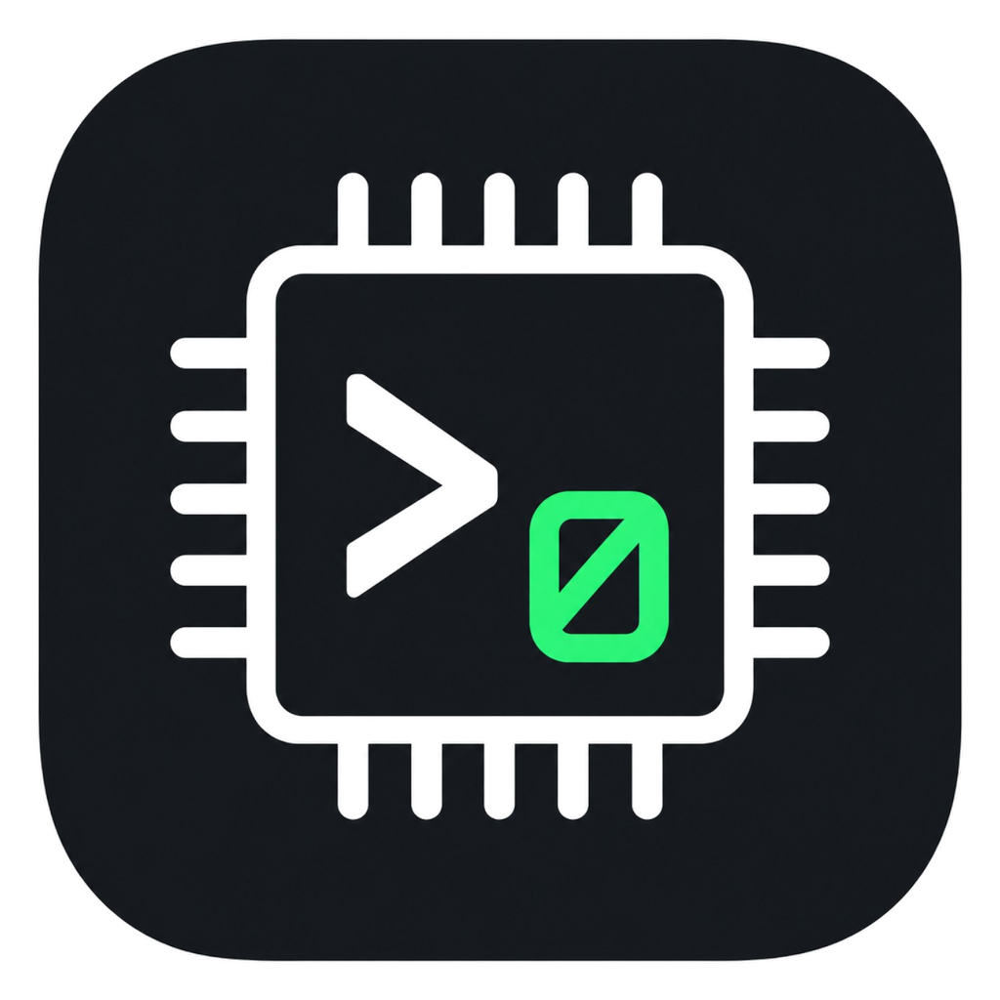

# term0



`term0` is a small cross-platform serial terminal written in C++ with Qt 6.
It is intended for Windows, Linux, and macOS.

It provides serial port discovery and hot-plug handling, configurable serial
framing, text and HEX transmit, Text/ANSI/HEX/HEX dump receive views, logging,
diagnostic logging, command history, common terminal key sequences, and simple
serial scripting.

**Releases:** [all releases](https://github.com/cmpdee/term0/releases) ·
[latest release](https://github.com/cmpdee/term0/releases/latest)

## Contents

- [Usage](#usage)
  - [Connecting](#connecting)
  - [Settings](#settings)
  - [Receive modes](#receive-modes)
  - [Transmit](#transmit)
  - [Terminal mode](#terminal-mode)
  - [Key sequences](#key-sequences)
  - [Logging](#logging)
  - [Diagnostic mode](#diagnostic-mode)
  - [Script Runner](#script-runner)
  - [Updates and version information](#updates-and-version-information)
  - [Other controls](#other-controls)
- [Requirements](#requirements)
- [Build](#build)
- [Run](#run)
- [Testing without serial hardware on Linux](#testing-without-serial-hardware-on-linux)
- [License](#license)

## Usage

### Connecting

The serial port and baud rate are set from the main window. The baud selector
contains common presets through 3,000,000 baud and also accepts a manually
entered value.

Select a port and baud rate, then press **Connect**. Port discovery is
automatic. `F5` forces a manual rescan.

If the active serial device is removed, `term0` disconnects automatically. If
the same port appears again, it is selected again but is not automatically
reconnected. After a fatal serial error, the serial port object is discarded
and a new one is created for the next connection.

### Settings

Press `Ctrl+Alt+S` to open Settings.

The **Serial** tab contains:

- data bits: 5, 6, 7, or 8
- parity: none, even, odd, mark, or space
- stop bits: 1, 1.5, or 2
- flow control: none, RTS/CTS, or XON/XOFF
- DTR
- RTS

Serial settings are applied to the next connection and cannot be changed while
the port is open. View, logging, and diagnostic options can be changed while
connected.

Settings are stored in a regular INI file:

```text
%APPDATA%\term0\term0.ini        Windows
~/.config/term0/term0.ini        Linux
```

On other platforms, `term0` uses the Qt application configuration directory.

### Receive modes

**Text** displays printable data normally. CR, LF, and TAB are preserved;
other control bytes are displayed as `.`.

**ANSI** is a lightweight shell-oriented display mode. Select this mode to
interpret terminal escape sequences; switching to it also re-renders the retained
raw RX history. It handles common ANSI SGR colors, CR/LF, backspace, TAB, basic cursor movement and positioning, line
and screen erase commands, and suppresses common OSC title sequences. Unknown/private
sequences are ignored. This mode is intended to make ordinary serial Linux
shell output easier to read; it is not a full VT100/xterm emulator and is not
intended for full-screen applications such as `vim`, `top`, `htop`, or `mc`.

**HEX** displays every received byte as hexadecimal. Receiving `0x0A` starts a
new display row.

**HEX dump** displays 16 bytes per row with offsets and an ASCII column:

```text
00000000  00 4D 50 59 3A 20 63 61  6E 27 74 20 6D 6F 75 6E  |.MPY: can't moun|
00000010  74 20 66 6C 61 73 68 0D  0A 4D 69 63 72 6F 50 79  |t flash..MicroPy|
```

### Transmit

Enter text in the Send field and press Enter or **Send**. **CR** and **LF**
control which line-ending bytes are appended in text mode.

Use Up/Down in the Send field to browse commands sent during the current
application session. Command history is kept in memory only.

Enable **HEX** next to the Send field to send byte values instead of text:

```text
00 4D 50 59
```

Compact input such as `004D5059` and optional `0x` prefixes are also accepted.
CR/LF are not added automatically in HEX transmit mode; send `0D` and `0A`
explicitly when needed.

### Terminal mode

Press `Ctrl+Alt+V` to toggle a temporary shell-oriented terminal preset. It is
intended for ordinary Linux serial consoles and changes only the relevant view
and transmit controls:

- RX view: **ANSI**
- TX HEX: off
- CR: on
- LF: off
- Key sequences strip: shown

While the preset is active, `TERM` is shown in the status line. Press
`Ctrl+Alt+V` again to restore the RX view, TX mode, and CR/LF selection that
were active before entering Terminal mode. The Key sequences strip is closed
when leaving the mode. The preset is not saved over those normal preferences if
`term0` is closed while it is active.

Baud rate, framing, flow control, DTR/RTS, logging, and the serial connection
state are not changed. This remains the same lightweight ANSI display described
above; it is not a full VT100/xterm emulator.

`Ctrl+Alt+V` is used instead of `Ctrl+Alt+T` because many Linux desktop
environments reserve `Ctrl+Alt+T` for launching a system terminal.

### Key sequences

Press `Ctrl+Alt+K` to toggle a one-line Key sequences strip above the Send
field. It sends common terminal keys directly as bytes, so their escape
sequences do not have to be entered as HEX. The strip contains Esc, arrows,
Home/End, Page Up/Page Down, Tab, Backspace, Delete, Enter, and
Ctrl+C/Ctrl+D/Ctrl+Z/Ctrl+\.

Press `Ctrl+Alt+K` again to return to the normal compact layout. Enter uses the
current CR/LF selection from the main window.

### Logging

The **Log** tab selects the live log format: **Text**, **HEX**, or **HEX dump**.
Timestamps can be enabled independently.

Press **Log** and choose a `.txt` file. Suggested filenames reflect the
selected format:

```text
term0-log.txt
term0-log_hex.txt
term0-log_hexdump.txt
```

When timestamps are enabled, the current local date and time are appended to
the suggested filename. Only RX data received after logging starts is written.
Press **Stop Log** to flush and close the file.

Text logging follows the Text receive convention. HEX logging follows the HEX
view line-break behavior. HEX dump logging writes 16-byte rows with offsets and
an ASCII column. When timestamps are enabled, each logged row or line is
prefixed with the local date and time.

`Ctrl+S` saves the retained RX history as plain text. This can be used when
output was received before live logging was started.

### Diagnostic mode

The **Debug** tab enables a separate diagnostic log:

```text
%APPDATA%\term0\term0-debug.log        Windows
~/.config/term0/term0-debug.log        Linux
```

The diagnostic log records port discovery and hot-plug events, available USB
serial metadata, applied serial settings, open/close events, DTR/RTS changes,
serial errors, and RX/TX activity. It is separate from the RX log and is
rotated when it grows beyond approximately 2 MiB.

`DBG` appears in the status line while diagnostic logging is enabled. The Debug
tab also provides **Open log folder** and **Copy diagnostics**.

### Script Runner

Press `Ctrl+Alt+R` to open the Script Runner. Scripts are plain text files,
typically saved with the `.t0s` extension. Script execution is asynchronous,
so the terminal remains responsive while a script is waiting.

Supported commands:

```text
# comment
send "text"
sendln "text"
hex "04 FF 00"
key esc
key up
key ctrl+c
sleep 500
expect "READY" timeout 3000
dtr on
rts off

sendlines 500 {
version
status
show configuration
}

repeat 3 {
    sendln "status"
    sleep 500
}
```

`sendln` appends the CR/LF selection from the main window. `sendlines <ms> { ... }`
is intended for pasted command sequences: each non-empty line in the block is
sent as a line using the current CR/LF selection, with the specified delay in
milliseconds between lines. Lines inside a `sendlines` block are treated as
literal text, so they do not need quotes or `sendln`.

`key` sends common terminal keys without requiring their byte values. Supported
names are `esc`, `up`, `down`, `left`, `right`, `home`, `end`, `pgup`, `pgdn`,
`tab`, `backspace`, `delete`, `enter`, `ctrl+c`, `ctrl+d`, `ctrl+z`, and
`ctrl+\`. `key enter` uses the current CR/LF selection.

`expect` waits for matching RX bytes received after that command starts. `repeat`
blocks may be nested. **Stop** cancels script execution immediately.

The script language does not execute operating-system commands.

### Updates and version information

The **About** tab shows the `term0` version, Qt version, license, and repository.
**Check for updates** manually checks the latest GitHub Release. No update check
runs automatically at startup.

If a newer release is available, `term0` can open its release page in the
default browser. It does not download or install updates automatically.

### Other controls

- **Clear** or `Ctrl+L` clears the terminal display.
- `Ctrl++` / `Ctrl+-` changes the terminal font size.
- `Ctrl+0` resets the terminal font size.
- `Ctrl` + mouse wheel also changes the terminal font size.
- `F5` forces a serial port rescan.
- `Ctrl+Alt+V` toggles Terminal mode.
- `Ctrl+Alt+K` toggles the Key sequences strip.
- The status line shows the active port/settings, connection time, and RX/TX
  byte counters. While logging it also shows the logged byte count; diagnostic
  mode adds `DBG`.

The RX view, TX HEX mode, CR/LF selection, terminal font size, window geometry,
serial settings, logging preferences, diagnostic preference, and last script
path are retained between runs.

A small clue in the View tab points to one undocumented shortcut.

## Requirements

- CMake 3.21 or newer
- Ninja
- Qt 6.2 or newer with `Widgets`, `SerialPort`, `Concurrent`, and `Network`
- a C++20 compiler

## Build

### Windows

The easiest setup is Qt Online Installer with a 64-bit MinGW desktop kit.
Install the matching Qt Serial Port component as well as CMake, Ninja, and
MinGW.

If the Qt tools and compiler are available through `PATH`, build with:

```powershell
.\build-windows.bat
```

The executable is created at:

```text
build-windows\term0.exe
```

If `windeployqt` is also available through `PATH`, the script creates a
portable `dist` directory automatically.

If Qt is not in `PATH`, configure the build explicitly. For example, with
Qt 6.12.0 installed in `C:\Qt`:

```powershell
cmake `
  -S . `
  -B build-windows `
  -G Ninja `
  -DCMAKE_BUILD_TYPE=Release `
  -DQt6_ROOT=C:\Qt\6.12.0\mingw_64

cmake --build build-windows --parallel
```

To prepare the portable directory manually:

```powershell
New-Item -ItemType Directory -Force .\dist | Out-Null
Copy-Item .\build-windows\term0.exe .\dist\term0.exe

& "C:\Qt\6.12.0\mingw_64\bin\windeployqt.exe" `
    --release `
    --no-translations `
    .\dist\term0.exe
```

Keep the complete `dist` directory together. `term0` uses Qt Network for the
manual update check, so the portable build includes the networking components
selected by `windeployqt`.

### Linux

On Debian/Ubuntu, install the compiler, CMake, Ninja, Qt development files, and
Qt Serial Port. Depending on the distribution release, the Serial Port package
may be named `qt6-serialport-dev`:

```bash
sudo apt install build-essential cmake ninja-build qt6-base-dev qt6-serialport-dev
```

or `libqt6serialport6-dev`:

```bash
sudo apt install build-essential cmake ninja-build qt6-base-dev libqt6serialport6-dev
```

Build with:

```bash
./build-linux.sh
```

The executable is created at:

```text
build/term0
```

If access to a physical serial device is denied, check the device permissions.
On Debian/Ubuntu, USB serial devices are commonly assigned to the `dialout`
group:

```bash
sudo usermod -aG dialout "$USER"
```

Log out and back in after changing group membership.

### macOS

Install Qt 6 with the Serial Port module, CMake, Ninja, and a C++20 compiler.
Then build with the Qt CMake wrapper:

```bash
/path/to/Qt/6.x/macos/bin/qt-cmake \
    -S . \
    -B build \
    -G Ninja \
    -DCMAKE_BUILD_TYPE=Release

cmake --build build --parallel
```

CMake creates `term0.app` and includes the application icon in the bundle.

## Run

### Windows

Run the local build with:

```powershell
.\build-windows\term0.exe
```

For a portable build:

```powershell
.\dist\term0.exe
```

The DLLs and plugin directories created by `windeployqt` must remain next to
the executable.

### Linux

```bash
./build/term0
```

### macOS

```bash
open ./build/term0.app
```

## Testing without serial hardware on Linux

A virtual serial pair can be created with `socat`:

```bash
socat -d -d pty,raw,echo=0 pty,raw,echo=0
```

It prints two `/dev/pts/N` paths. Enter one path in `term0` and use the other
from a shell. For example:

```bash
printf '\x00MPY: test\r\n' > /dev/pts/N
```

## License

BSD 3-Clause License.
